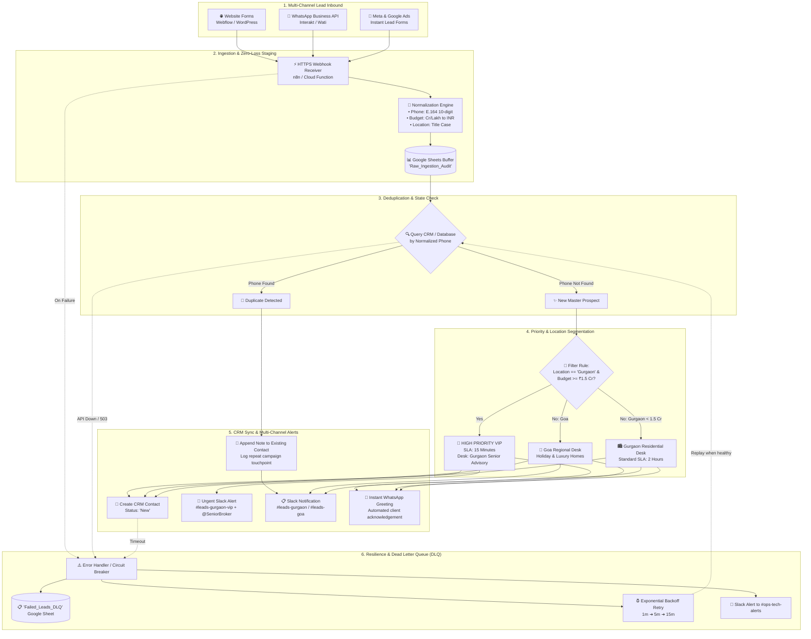
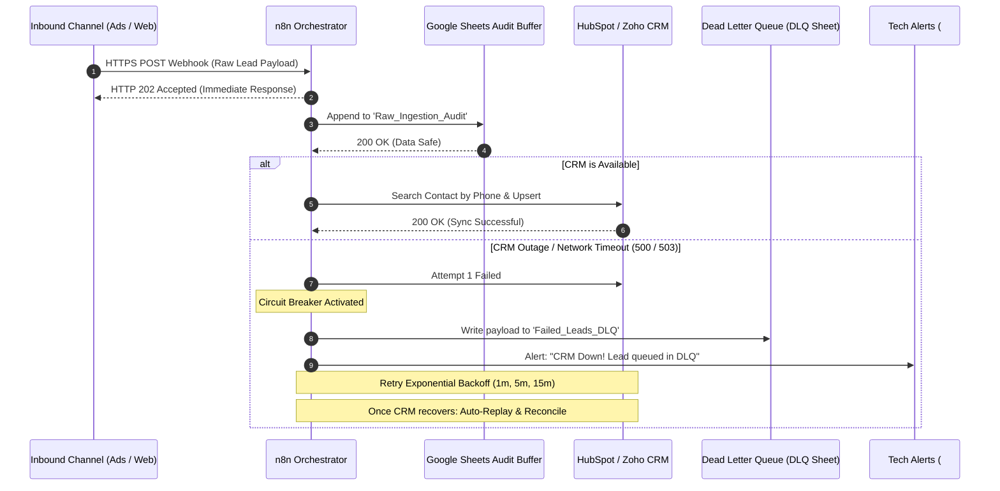
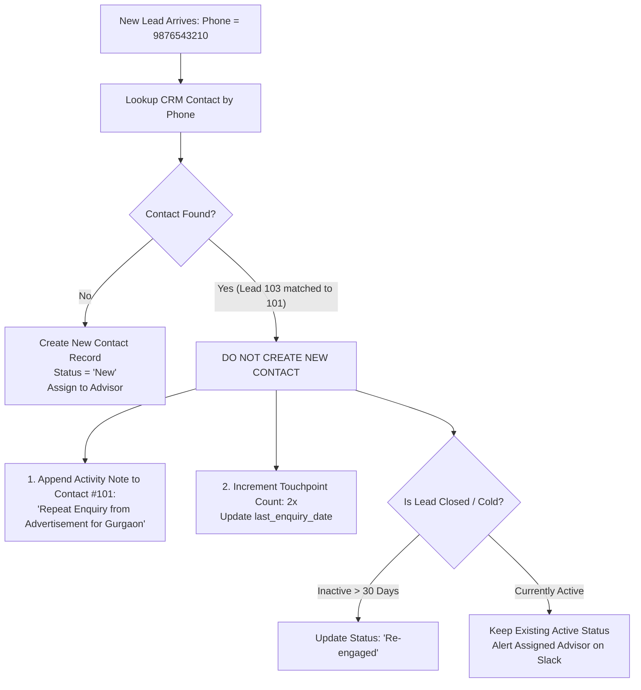
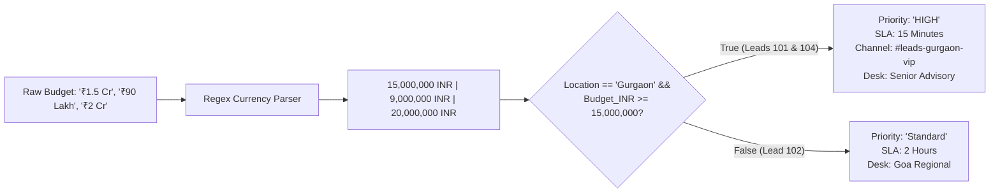

# Proppr Real Estate Advisory — Lead Management Automation Assignment
**Author:** Candidate Submission  
**Operating Markets:** Gurgaon & Goa  
**Core Technologies:** n8n / Make, Google Sheets, HubSpot / Zoho CRM, Python 3.13, REST APIs & Webhooks  
**Interactive Simulator:** Running locally at `http://localhost:8000` (`index.html`)

---

## Executive Summary

Proppr operates in high-velocity, high-ticket real estate markets (Gurgaon and Goa). In these markets, speed to lead, contextual follow-up, and zero data leakage directly impact revenue. Prospective luxury property buyers frequently interact across multiple channels (browsing website property pages, submitting enquiry forms, messaging over WhatsApp, or clicking targeted Meta/Google Ads). 

Manually entering lead details into spreadsheets or CRM causes:
1. **Response Latency:** Delays of hours or days before a sales agent reaches out. In luxury real estate, reaching out within **15 minutes** increases conversion rates by up to 300%.
2. **Duplicate Clutter:** The same buyer submitting enquiries across multiple campaigns creates duplicate CRM records, causing multiple agents to call the same prospect and irritating high-net-worth individuals (HNWIs).
3. **Data Inconsistency:** Inconsistent budget entries (e.g., "1.5 Cr", "150 Lacs", "1.5crores") prevent accurate segmentation and prioritization.
4. **Single Point of Failure:** System downtimes or API rate limits risk dropping valuable leads silently.

This submission presents an **end-to-end automated lead management architecture** built on the principles of **idempotency, asynchronous decoupling, deterministic data normalization, and fault-tolerant error recovery**.

---

## Task 1: Design a Lead Management Automation Workflow

### 1.1 High-Level Architecture Diagram



---

### 1.2 Step-by-Step Workflow Explanation

#### Step 1: Multi-Channel Lead Ingestion
- **Website:** Inbound property form submissions (e.g., Webflow, WordPress, custom React frontend) trigger an HTTPS `POST` webhook to our orchestration endpoint (`/webhook/proppr-lead-intake`).
- **WhatsApp:** WhatsApp Business API solution providers (e.g., Wati, Interakt, Gupshup) dispatch a webhook payload whenever a customer sends an enquiry message or completes an interactive WhatsApp list/form.
- **Online Advertising:** Meta Graph API (LeadGen Webhook) and Google Ads Webhook trigger automatically upon instant form completion.

#### Step 2: Ingestion Normalization & Zero-Loss Buffer
Before touching downstream CRM systems, raw data is immediately parsed and validated:
1. **Phone Number Normalization:** Removes spaces, hyphens, parentheses, and standardizes prefixes (`+91` or leading `0`) into canonical 10-digit Indian mobile format (e.g., `9876543210`).
2. **Indian Currency Budget Parser:** Real estate budgets in India arrive in vernacular formats ("₹1.5 Cr", "90 Lakhs", "2 Crore", "75L"). Our parser converts these into exact numerical INR integers (`15,000,000`, `9,000,000`, `20,000,000`) for deterministic querying.
3. **Timestamping:** Lead is stamped with ISO UTC timestamp and IST local time.
4. **Google Sheets Raw Staging Buffer:** Every valid payload is appended to a master `Raw_Ingestion_Audit` tab. This creates an unalterable audit log and ensures zero data loss even if the CRM or internet goes down.

#### Step 3: Duplicate Identification & Contact Resolution
- The automation performs an API lookup against the CRM (or Google Sheets directory) using the normalized 10-digit phone number as the **primary unique key**.
- **Case A — Existing Contact (Duplicate/Multi-Touch Enquiry):**
  - Do **not** create a new contact record.
  - Append an **Engagement Note / Activity** to the existing contact:  
    *“Repeat enquiry received via [Source] on [Enquiry Date] for [Location] with budget [Budget].”*
  - Increment the contact's `touchpoint_count` and update `last_enquiry_date`.
  - Alert the assigned advisor on Slack/WhatsApp so they have full context before calling the client.
- **Case B — New Contact:**
  - Proceed to priority evaluation and CRM contact creation.

#### Step 4: Priority Flagging & Operational Routing
- **High-Priority Gurgaon VIP Filter:**
  - **Condition:** `Preferred Location == 'Gurgaon'` AND `Budget_INR >= 15,000,000` (₹1.5 Cr).
  - **Tagging:** Stamped with `Priority = 'HIGH'` and strict `SLA_Target = '15 Minutes'`.
  - **Routing:** Assigned to **Gurgaon Senior Advisory Team** / luxury brokers.
- **Regional Goa Routing:**
  - Leads interested in Goa are routed to the **Goa Holiday & Luxury Advisory Desk**.
- **Standard Gurgaon Routing:**
  - Leads interested in Gurgaon with budget < ₹1.5 Cr are routed to the **Gurgaon Residential Desk** (SLA: 2 hours).

#### Step 5: CRM Record Creation & Notifications
- **CRM Sync:** Contact is created in CRM (HubSpot / Zoho) with initial follow-up status = `New`.
- **Internal Team Alert (Slack / WhatsApp):**
  - High-priority leads trigger a rich alert to `#leads-gurgaon-vip` mentioning on-duty team leads.
  - Regional leads trigger notifications to `#leads-gurgaon` or `#leads-goa`.
- **Client Auto-Acknowledgement:**
  - An instant, personalized WhatsApp message is sent to the customer:  
    *“Hello [Name], thank you for reaching out to Proppr regarding properties in [Location]. Our Senior Property Advisor has been assigned to your enquiry and will connect with you within 15 minutes.”*

#### Step 6: Follow-Up Status Lifecycle Management
Every lead moves through defined operational stages:
1. `New`: Lead captured and assigned; awaiting first sales outreach.
2. `Contacted`: Outreach attempted (phone call placed or WhatsApp conversation initiated).
3. `Qualified`: Buyer timeline, budget, and specific project requirements verified.
4. `Site Visit Scheduled`: Key real estate milestone; property tour confirmed.
5. `Negotiation / Booking`: Developer offer sheet or token payment stage.
6. `Closed`:
   - `Closed - Won`: Property purchased / deal executed.
   - `Closed - Lost`: Buyer cold, purchased elsewhere, or disqualified (with mandatory loss reason).

---

### 1.3 Recommended Tool Stack & Communication Protocols

| Component | Recommended Tool | Alternative Tool | Communication Protocol | Rationale |
| :--- | :--- | :--- | :--- | :--- |
| **Workflow Orchestrator** | **n8n** (Cloud / Self-Hosted) | Make.com / Zapier | Webhooks (HTTPS POST), REST APIs | Open-source, no per-task licensing cost, native code nodes for complex Indian currency parsing, visual debugging. |
| **Primary CRM** | **HubSpot CRM** | Zoho CRM / Salesforce | REST API (OAuth 2.0 / Bearer Tokens) | Native contact vs deal hierarchy, robust search-by-phone API, custom property support. |
| **Data Staging & Backup** | **Google Sheets** | Airtable / PostgreSQL | Google Sheets API v4 | Fast collaborative visibility for SDRs, zero-loss raw audit logging, free and highly reliable. |
| **Team Notifications** | **Slack** | Microsoft Teams | Incoming Webhooks | Rich formatted cards with CRM quick links, location-specific channels. |
| **Customer Messaging** | **WhatsApp Business API** (Interakt / Wati) | Twilio SMS | REST API (JSON payloads) | 98% open rates in Indian real estate; instant two-way engagement. |

---

### 1.4 Failure Handling & Reliability Strategy



1. **Immediate Webhook Acknowledgement (HTTP 202):** The intake webhook responds immediately to Meta/Google/Website within 500ms, preventing advertising platforms from timing out or retrying duplicate requests.
2. **Decoupled Buffer:** Data is written to Google Sheets *before* any CRM API calls. Even if CRM credentials expire or the CRM suffers a global outage, the raw lead is permanently preserved.
3. **Automated Exponential Backoff:** If the CRM API returns `429 Too Many Requests` or `5xx Server Error`, the orchestrator executes retries after 1 minute, 5 minutes, and 15 minutes.
4. **Dead Letter Queue (DLQ):** Leads that fail after 3 attempts are diverted to a dedicated `Failed_Leads_DLQ` tab with the raw payload, error code, and stack trace.
5. **Circuit Breaker Alerting:** An instant alert is posted to `#ops-tech-alerts` with a one-click manual retry URL.

---

## Task 2: Demonstrate Your Automation Logic

### Evaluation of Sample Leads Dataset

| Lead ID | Prospect Name | Phone Number | Location | Budget | Source | Classification & Action |
| :---: | :--- | :---: | :---: | :---: | :---: | :--- |
| **101** | Rahul Sharma | `9876543210` | Gurgaon | ₹1.5 Cr | Website | **Master Lead — High Priority Gurgaon VIP** (>= ₹1.5 Cr) |
| **102** | Priya Mehta | `9876543211` | Goa | ₹90 Lakh | WhatsApp | **Master Lead — Goa Holiday & Luxury Desk** |
| **103** | Rahul Sharma | `9876543210` | Gurgaon | ₹1.5 Cr | Advertisement | <strong style="color:#d97706;">DUPLICATE OF LEAD 101</strong> (Same phone: `9876543210`) |
| **104** | Amit Verma | `9876543212` | Gurgaon | ₹2 Cr | Website | **Master Lead — High Priority Gurgaon VIP** (₹2 Cr >= ₹1.5 Cr) |

---

### Detailed Answers to the 5 Questions

#### 1. Which leads would you flag as potential duplicates, and why?
**Answer:** **Lead 101 and Lead 103** must be flagged as duplicates.

* **Primary Reason:** Both records share the exact same normalized phone number (`9876543210`) and identical prospect name (*Rahul Sharma*).
* **Real Estate Multi-Touch Context:** Lead 101 arrived via the **Website**, and Lead 103 arrived later via an online **Advertisement** (Meta or Google Ads). In high-value real estate purchases, prospective buyers often submit an enquiry form on the website and later click a retargeting ad while browsing social media. 
* Flagging this prevents treating Rahul Sharma as two separate buyers, which would otherwise result in two different Proppr advisors calling him simultaneously.

---

#### 2. How would you ensure duplicate enquiries do not create unnecessary CRM records?
**Answer: Implement the "Search-Before-Insert / Upsert Pattern" with an Entity Separation between Contacts and Activities.**



1. **Phone Number as Primary Deduplication Key:** The CRM Contact table indexes `phone_number` as a unique identifier.
2. **Contact vs Touchpoint Separation:**
   * A **Contact** represents the human buyer (one unique record per phone number).
   * An **Enquiry / Touchpoint** represents an interaction (a one-to-many relationship under the Contact).
3. **Execution Logic for Lead 103:**
   * Query CRM: `GET /contacts?phone=9876543210`. Contact #101 is returned.
   * Skip Contact Creation.
   * Append an **Engagement Timeline Note** under Contact #101:  
     *“Repeat enquiry received via Advertisement on 2026-10-28 14:45. Location: Gurgaon, Budget: ₹1.5 Cr.”*
   * Update Contact fields: `touchpoint_count = 2`, `touchpoint_sources = ['Website', 'Advertisement']`, `last_enquiry_date = NOW()`.
   * Notify the currently assigned sales advisor:  
     *“Repeat touchpoint alert: Your client Rahul Sharma just clicked an online ad for Gurgaon.”*

---

#### 3. If a lead has a budget of ₹1.5 Cr or above and is interested in Gurgaon, how would you flag it for priority follow-up?
**Answer: Deterministic Indian Currency Normalization + Conditional Branching + SLA Automation.**



1. **Indian Currency Parsing Logic:**
   Colloquial budget strings must be converted to raw numerical INR:
   ```python
   def parse_indian_budget(text: str) -> float:
       # Extracts number and multiplies by 10^7 for Cr, 10^5 for Lakh
       if "cr" in text.lower():
           return float(re.findall(r"\d+\.?\d*", text)[0]) * 10_000_000
       elif "lakh" in text.lower() or "lac" in text.lower():
           return float(re.findall(r"\d+\.?\d*", text)[0]) * 100_000
       return float(re.findall(r"\d+\.?\d*", text)[0])
   ```
2. **Evaluation on Sample Leads:**
   * **Lead 101 (Rahul Sharma):** `Gurgaon` + `15,000,000` &rarr; **MATCHES CRITERIA &rarr; HIGH PRIORITY**
   * **Lead 102 (Priya Mehta):** `Goa` + `9,000,000` &rarr; Standard Priority (Goa Desk)
   * **Lead 103 (Rahul Sharma):** Duplicate of 101 &rarr; Reinforced VIP follow-up
   * **Lead 104 (Amit Verma):** `Gurgaon` + `20,000,000` &rarr; **MATCHES CRITERIA &rarr; HIGH PRIORITY**
3. **Automated Priority Actions:**
   * Set CRM fields: `priority = "HIGH"`, `sla_minutes = 15`.
   * Dispatch urgent Slack notification to `#leads-gurgaon-vip` tagging `@senior_advisors`.
   * Trigger an automated personalized WhatsApp message to the prospect within 60 seconds acknowledging their enquiry.

---

#### 4. What would you do if the CRM was unavailable when a new lead arrived?
**Answer: Asynchronous Decoupling, Google Sheets Staging Buffer, and Self-Healing Circuit Breakers.**

1. **Never Depend on Direct Synchronous Calls:** The webhook endpoint never waits synchronously for the CRM to respond before answering the lead source. It returns `HTTP 202 Accepted` immediately, preventing advertising channels from dropping the connection.
2. **Immediate Staging Persistence:** The incoming payload is written to an independent, highly available data store (**Google Sheets `Raw_Ingestion_Audit`** or AWS SQS) with sync status: `PENDING_CRM_SYNC`.
3. **Circuit Breaker & Retry Schedule:**
   * When CRM calls fail (HTTP 500/503 or socket timeout), the automation halts direct sync attempts and triggers a retry queue.
   * **Retry Policy:** Exponential backoff at 1 min, 5 min, 15 min, and 1 hour intervals.
4. **Dead Letter Queue (DLQ) & Ops Notification:**
   * If the CRM remains down after all retries, the lead is moved to `Failed_Leads_DLQ` in Google Sheets.
   * An urgent alert is posted to `#ops-tech-alerts` with lead contact details so that advisors can pick up their phones and call the client immediately using the spreadsheet row, while engineers troubleshoot the CRM.
5. **Automated Reconciliation Cron:**
   * A health-check script pings the CRM endpoint every 15 minutes.
   * As soon as the CRM recovers (HTTP 200), a reconciliation workflow queries all rows marked `PENDING_CRM_SYNC` and drains them sequentially into the CRM with zero data loss.

---

#### 5. How would you prevent a failed workflow from processing the same lead multiple times?
**Answer: Deterministic Idempotency Keys and Atomic State Machine Checkpointing.**

1. **Deterministic Idempotency Key Generation:**
   Every lead is assigned a unique, immutable hash calculated from its core identity:
   $$\text{Idempotency Key} = \text{SHA256}(\text{normalized\_phone} + \text{source} + \text{enquiry\_date})$$
   *(For Meta Ads or WhatsApp, the native unique transaction ID such as `leadgen_id` or WhatsApp `message_id` is used).*
2. **Explicit Lifecycle State Tracking:**
   Every lead in the staging table maintains an atomic state:
   $$\text{[INGESTED]} \longrightarrow \text{[BUFFERED]} \longrightarrow \text{[CRM\_SYNCED]} \longrightarrow \text{[NOTIFIED]} \longrightarrow \text{[COMPLETED]}$$
3. **Pre-Execution Guard:**
   * Before executing side-effects (e.g., creating a CRM contact, sending a WhatsApp message to the customer, or triggering a Slack alert), the node performs an atomic lookup:
     ```python
     if lead_state.get(idempotency_key) in ["COMPLETED", "CRM_SYNCED"]:
         return "SKIPPED_ALREADY_PROCESSED"
     ```
4. **Step-Level Resumption (No Duplicate Outreach):**
   * If a workflow successfully writes to Google Sheets and creates the CRM contact, but fails at the Slack notification step due to a Slack API rate limit, the retry resumes **only** at the failed Slack node. It will **not** create a duplicate CRM record or send duplicate greetings to the client.

---

## Task 3: Practical Tool Knowledge

*(Both Option A and Option B have been completed in full to provide maximum technical demonstration).*

### Option A — No-Code Automation (n8n Workflow Blueprint)

A complete, production-grade workflow has been designed and exported to `workflows/n8n_proppr_lead_workflow.json`.

```
┌────────────────────────────────────────────────────────────────────────┐
│                        n8n WORKFLOW NODE GRAPH                         │
└────────────────────────────────────────────────────────────────────────┘

[1. Inbound Webhook]
        │
        ▼
[2. Code Node: Phone Normalizer & Indian Budget Parser]
        │
        ▼
[3. Google Sheets: Zero-Loss Raw Ingestion Audit Buffer]
        │
        ▼
[4. HubSpot CRM: Search Contact by Phone]
        │
        ▼
[5. IF Node: Contact Found? (Duplicate Check)]
        ├── TRUE (Duplicate) ───────────────────────────────────┐
        │   ▼                                                   │
        │   [6. HubSpot: Append Touchpoint Note]                │
        │   ▼                                                   │
        │   [7. Slack: Notify Assigned Advisor of Repeat]       │
        │                                                       │
        └── FALSE (New Contact) ────────────────────────────────┘
            ▼
            [8. IF Node: Location == 'Gurgaon' && Budget >= 1.5 Cr?]
            ├── TRUE (High-Priority VIP) ────────────────────────┐
            │   ▼                                                │
            │   [9. HubSpot: Create VIP Contact (Status: New)]   │
            │   ▼                                                │
            │   [10. Slack: Urgent Alert #leads-gurgaon-vip]     │
            │                                                    │
            └── FALSE (Standard Priority) ───────────────────────┘
                ▼
                [11. HubSpot: Create Standard Contact]
                ▼
                [12. Slack: Notify Regional Desk (#leads-goa)]

[13. Error Trigger Node (Catches any failure in graph)]
        │
        ▼
[14. Google Sheets: Append to 'Failed_Leads_DLQ']
        │
        ▼
[15. Slack: Immediate Alert to #ops-automation-alerts]
```

#### Node-by-Node Explanation:
1. **Node 1: Webhook Trigger (`proppr-lead-intake`):** Listens for incoming HTTP POST requests containing `name`, `phone_number`, `location`, `budget`, and `source`.
2. **Node 2: Code Node (JavaScript Normalizer):**
   - Normalizes phone numbers (strips non-digits, trims country code to 10 digits).
   - Parses `₹1.5 Cr`, `₹90 Lakh`, `₹2 Cr` to numerical INR integers.
   - Computes `is_priority` boolean and assigns desk routing.
3. **Node 3: Google Sheets Buffer (`Raw_Ingestion_Audit`):** Saves the clean payload to Google Sheets prior to external CRM calls.
4. **Node 4: HubSpot Contact Search:** Queries `phone = {{ $json.phone_number }}`.
5. **Node 5: IF Duplicate Found:** Branches flow based on whether a contact ID is returned.
6. **Nodes 6 & 7: Duplicate Branch:** Appends an engagement note to the existing contact and alerts the sales rep without creating a new contact.
7. **Node 8: Priority Filter:** Evaluates if the prospect is interested in Gurgaon with budget &ge; ₹1.5 Cr.
8. **Nodes 9 & 10: VIP Branch:** Creates CRM contact with `Priority = HIGH`, sets 15-minute SLA, and posts an urgent alert in `#leads-gurgaon-vip`.
9. **Nodes 11 & 12: Standard Branch:** Creates CRM contact and routes to `#leads-goa` or `#leads-gurgaon`.
10. **Nodes 13, 14 & 15: Error Trigger & DLQ Sub-Workflow:** Catches any API exceptions, logs the error and raw payload to a Dead Letter Queue sheet, and alerts tech operations on Slack.

---

### Option B — Basic Coding (Python Implementation)

A production-tested Python script has been implemented in `scripts/lead_processor.py`.

#### Core Implementation Snippet:
```python
import re
from typing import Dict, List, Tuple, Any

def normalize_phone(phone_raw: Any) -> str:
    """Standardizes Indian phone numbers into canonical 10-digit format."""
    digits = re.sub(r"\D", "", str(phone_raw))
    if len(digits) == 12 and digits.startswith("91"):
        digits = digits[2:]
    elif len(digits) == 11 and digits.startswith("0"):
        digits = digits[1:]
    return digits

def parse_indian_budget(budget_str: Any) -> float:
    """Parses ₹1.5 Cr, ₹90 Lakh, ₹2 Cr into numerical INR values."""
    text = str(budget_str).strip().lower()
    num_match = re.search(r"(\d+(?:\.\d+)?)", text)
    if not num_match:
        return 0.0
    value = float(num_match.group(1))
    if "cr" in text or "crore" in text:
        return value * 10_000_000
    elif "lakh" in text or "lac" in text or "l" in text:
        return value * 100_000
    return value

def evaluate_priority(location: str, budget_inr: float) -> Tuple[bool, str]:
    """Flags priority: Budget >= ₹1.5 Cr (15M INR) AND Location is 'Gurgaon'."""
    is_gurgaon = location.strip().lower() == "gurgaon"
    meets_budget = budget_inr >= 15_000_000
    if is_gurgaon and meets_budget:
        return True, "HIGH PRIORITY (Gurgaon >= ₹1.5 Cr)"
    return False, "STANDARD"
```

#### Execution Output:
```
================================================================================
 PROPPR REAL ESTATE ADVISORY - LEAD AUTOMATION REPORT 
================================================================================
Total Ingested Leads : 4
Unique Master Leads  : 3
Duplicate Enquiries  : 1
High-Priority Leads  : 2
--------------------------------------------------------------------------------

[+] MASTER CLEANED CRM RECORDS (Unique Contacts to Sync):
ID     Name             Phone        Location   Budget       Priority               Team Assigned               
--------------------------------------------------------------------------------------------------------------
101    Rahul Sharma     9876543210   Gurgaon    ₹1.5 Cr      [PRIORITY] HIGH PRIORIT Gurgaon Senior Advisory Team
       └─ Multi-Touch Lead! 2 enquiries from sources: [Website, Advertisement]
102    Priya Mehta      9876543211   Goa        ₹90 Lakh     [STANDARD] STANDARD (Go Goa Holiday & Luxury Advisory Desk
104    Amit Verma       9876543212   Gurgaon    ₹2 Cr        [PRIORITY] HIGH PRIORIT Gurgaon Senior Advisory Team

[+] DUPLICATE ENQUIRIES LOG (Appended to existing contacts, not duplicate CRM records):
Dup ID   Master ID  Name             Phone        New Source      Flag Reason                        
----------------------------------------------------------------------------------------------------
103      #101       Rahul Sharma     9876543210   Advertisement   Phone number '9876543210' already registered to #101
================================================================================

[+] Cleaned leads exported to 'scripts/cleaned_leads.json'
[+] Duplicate audit log exported to 'scripts/duplicate_leads.json'
```

#### Verification Suite:
The script includes built-in unit tests asserting:
1. Phone normalization across `+91`, `0`, spaces, and hyphens.
2. Budget parsing accuracy for Crore, Lakh, and raw decimals.
3. Priority evaluation logic across Gurgaon and Goa combinations.
4. Correct duplicate linkage of Lead 103 to Master Lead 101.

---

## Task 4: Documentation and Communication

### Non-Technical Operational Guide for Proppr Sales & Advisory Team

#### 1. What the Automation Does (In Plain English)
Think of this automation as Proppr's **24/7 Digital Concierge**:
* **No More Manual Data Entry:** When a prospective home buyer fills out an enquiry form on our website, messages us on WhatsApp, or clicks our Facebook/Instagram ads, their information is captured instantly. You will never have to copy-paste names and phone numbers between spreadsheets and CRM again.
* **Smart Duplicate Detection:** In luxury real estate, buyers often enquire on our website and then click an ad a few days later. Our system recognizes them by their phone number. Instead of creating a confusing second lead that gets assigned to another broker, it updates their existing file and alerts you: *"Your client just enquired on a new ad!"*
* **VIP Priority Tagging:** If an enquiry arrives for Gurgaon with a budget of **₹1.5 Crore or above**, the system tags it as *High Priority*, triggers an urgent alert in `#leads-gurgaon-vip`, and sets an immediate **15-minute response timer**.

---

#### 2. How the Team Will Use It Day-to-Day
Your daily routine is streamlined into three simple touchpoints:
* **Instant Notifications:** The moment a lead submits an enquiry, you will receive an alert in your team channel (`#leads-gurgaon` or `#leads-goa`) containing the buyer's name, phone, budget, and a direct link to their CRM profile.
* **Structured Follow-up Stages:** In the CRM, every lead progresses through clear milestones:
  * `New`: Just arrived; waiting for your first call.
  * `Contacted`: You have called or sent a WhatsApp message.
  * `Qualified`: You have confirmed their budget, timeline, and property preferences.
  * `Site Visit Scheduled`: You have locked in a site tour.
  * `Closed`: Deal won or closed.
* **No Client Collisions:** Because phone numbers are deduplicated, two advisors will never call the same client by mistake.

---

#### 3. What Happens When Something Goes Wrong
We have built multi-layered fail-safes so that **no lead is ever lost**:
* **Automatic Backup Sheet:** Every lead is recorded in a master Google Sheet the instant it arrives. Even if our CRM is experiencing an outage or internet connection drops, the lead is safely recorded.
* **Automatic Retries:** If the CRM system is busy, our automation silently waits and tries again after 1 minute, 5 minutes, and 15 minutes.
* **Immediate Escalation:** If an error persists, an alert is sent directly to our technical channel. Our on-duty operations manager will immediately ping the lead details to your phone so you can call the buyer right away while IT resolves the issue.

---

#### 4. Limitations and Future Improvements (Phase 2 Roadmap)
* **AI WhatsApp Qualification Bot:** In Phase 2, we can deploy an AI agent on WhatsApp that immediately responds to inbound leads with smart qualifying questions (e.g., *"Are you looking for an apartment or an independent villa?"*, *"Is this for self-use or investment?"*), pre-qualifying buyers before passing them to advisors.
* **Automated Property Matching:** When a lead arrives with a budget of ₹2 Cr in Gurgaon, the system can automatically send a customized, branded PDF brochure of matching properties via WhatsApp.
* **Smart Round-Robin Assignment:** Automatically distribute leads evenly among advisors based on their active workload and office hours, ensuring no single agent is overwhelmed.
* **Interactive Site Visit Scheduler:** Allow buyers to book a site visit slot directly from WhatsApp using an integrated calendar link.

---

## File Deliverables in Repository

| File Path | Description |
| :--- | :--- |
| `index.html` | Interactive Lead Management Simulator web dashboard (Pipeline visualizer, duplicate inspector, CRM downtime simulator). |
| `style.css` | Modern CSS design system with custom tokens, responsive tables, badges, and dark-mode glassmorphism. |
| `app.js` | Interactive client-side pipeline logic, stepper animation, deduplication, and budget parsing engine. |
| `scripts/lead_processor.py` | Complete Python implementation for Task 3 Option B with unit test suite. |
| `scripts/cleaned_leads.json` | Cleaned master CRM contacts output (Leads 101, 102, 104). |
| `scripts/duplicate_leads.json` | Duplicate audit log output (Lead 103 matched to Lead 101). |
| `workflows/n8n_proppr_lead_workflow.json` | Production-ready, importable n8n workflow blueprint with complete node definitions. |
| `SUBMISSION.md` | Master submission document covering Tasks 1, 2, 3, and 4 in exhaustive detail. |
